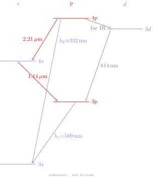

# B3 Atomic Problems — Questions and Answers

Source: `questions_and_answers/problem_sets/<problem-set-source-file>`

---

## Problem Set 1 — Q7

### Question

Explain what is meant by the central field approximation, and how it leads to the concept of configurations. State the Pauli exclusion principle, and show that it follows from the requirement that the wave-function describing a pair of fermions should be antisymmetric with respect to exchange. Account qualitatively for the order of filling of individual electron quantum states in atoms with atomic number up to $Z=36$.

Explain why the ionization potential of chlorine is less than that of argon, but more than that of potassium. How would you expect the second ionization potentials of these atoms to compare with each other? [The second ionization potential is the energy required to remove a further electron from the singly ionized atom.]

### Answer

#### Central Field Approximation

The full Hamiltonian for an $N$-electron atom is

$$H = \sum_{i=1}^{N} \left(-\frac{\hbar^2}{2m}\nabla_i^2 - \frac{Ze^2}{4\pi\epsilon_0 r_i} + \sum_{j>i} \frac{e^2}{4\pi\epsilon_0 r_{ij}}\right)$$

The two-body repulsion terms $r_{ij}^{-1}$ couple all electrons together, making the equation inseparable. The central field approximation replaces these repulsions with a single-body, spherically symmetric potential $U(r_i)$ that represents the average field of the other electrons:

$$H \approx H_0 = \sum_i h_i, \qquad h_i = -\frac{\hbar^2}{2m}\nabla_i^2 - \frac{Ze^2}{4\pi\epsilon_0 r_i} + U(r_i)$$

$U(r)$ behaves as $-e^2/4\pi\epsilon_0 r$ (hydrogen-like) at large $r$ and as $-Ze^2/4\pi\epsilon_0 r$ (bare nucleus) at small $r$. Because $H_0$ separates, each electron independently satisfies a hydrogen-like equation with solutions $\psi(n,l,m_l,m_s)$.

**Perturbative hierarchy.** The residual electrostatic interaction $H_1 = H - H_0$ is treated as a perturbation, and spin-orbit interaction as a still smaller perturbation $H_2$.

**Configurations.** Because the separable $H_0$ assigns each electron its own $(n,l)$, and because the energy of an electron in the central field depends on both $n$ and $l$ (unlike hydrogen, where it depends on $n$ only — due to core penetration), the state of the whole atom is specified by listing $(n,l)$ for every electron. This list is the **electron configuration**, written $nl^x$ (the superscript $x$ counts electrons with that $n,l$). The concept of configurations is therefore a direct consequence of the factorization of $H_0$.

---

#### Pauli Exclusion Principle and Antisymmetry

**Statement.** No two electrons can have identical values of all four quantum numbers $(n, l, m_l, m_s)$.

**Derivation from antisymmetry.** Electrons are fermions; the wavefunction of any pair must be antisymmetric under exchange of particle labels:

$$\psi(1,2) = -\psi(2,1)$$

For two electrons occupying single-particle states $a$ and $b$, the antisymmetric combination is

$$\psi(1,2) = \frac{1}{\sqrt{2}}\bigl[\phi_a(1)\phi_b(2) - \phi_a(2)\phi_b(1)\bigr]$$

(This is the $2\times2$ Slater determinant.) Now suppose $a = b$ — both electrons in the same state:

$$\psi(1,2) = \frac{1}{\sqrt{2}}\bigl[\phi_a(1)\phi_a(2) - \phi_a(2)\phi_a(1)\bigr] = 0$$

An identically-zero wavefunction cannot be normalised; it represents no physical state. The conclusion is that two fermions cannot occupy the same quantum state. This is Pauli's exclusion principle.

---

#### Order of Filling up to $Z=36$

Two principles govern the filling: **Pauli exclusion** (at most one electron per state) and **least energy** (fill the lowest available level first).

Each sub-shell $nl$ holds $2(2l+1)$ electrons (two spins, $2l+1$ values of $m_l$).

**$n=1$:** 1s holds 2 electrons. H: $1s$; He: $1s^2$.

**$n=2$:** 2s (2) then 2p (6). Li ($2s$) through Ne ($1s^2\,2s^2\,2p^6$).

**$n=3$:** 3s then 3p. Na ($3s$) through Ar ($1s^2\,2s^2\,2p^6\,3s^2\,3p^6$).

**Crossover at $Z=19$.** After Ar the naïve next step is 3d. However, a 3d electron ($l=2$) has a nearly circular orbit and stays outside the inner core, barely penetrating. A 4s electron ($l=0$) penetrates the core deeply, experiencing a less-screened nuclear charge and ending up more tightly bound than 3d. So potassium takes 4s before 3d:

| Z | Element | Outer electrons |
|---|---------|-----------------|
| 19 | K | $3s^2\,3p^6\;4s$ |
| 20 | Ca | $4s^2$ |
| 21–30 | Sc–Zn | 3d fills while 4s² occupied (transition metals) |
| 24 | Cr | $3d^5\,4s$ (half-filled 3d preferred over $3d^4\,4s^2$) |
| 30 | Zn | $3d^{10}\,4s^2$ |
| 31–36 | Ga–Kr | 4p fills: $3d^{10}\,4s^2\,4p^x$ |

Kr ($Z=36$): $[\text{Ar}]\;3d^{10}\,4s^2\,4p^6$.

---

#### Ionization Potentials of Cl, Ar, K

Configurations:
- Cl ($Z=17$): $[\text{Ne}]\;3s^2\,3p^5$
- Ar ($Z=18$): $[\text{Ne}]\;3s^2\,3p^6$
- K ($Z=19$): $[\text{Ar}]\;4s$

**IP(Cl) < IP(Ar).** Argon has completely filled 3s and 3p sub-shells. Filled sp sub-shells produce a spherically symmetric charge distribution in which all electrons share a common wavefunction configuration, yielding higher binding energy per electron. Breaking into this closed structure requires more energy. Chlorine is one electron short of this configuration; removing one of its 3p electrons does not sacrifice the same closed-shell stability.

**IP(Cl) > IP(K).** Potassium's outermost electron occupies 4s, well outside the inner [Ne]+3s²3p⁶ core. With 18 inner electrons almost fully screening the nucleus, the effective nuclear charge on the 4s electron is $Z_\text{eff} \approx 1$; the electron is weakly bound (IP $\approx 4.3$ eV). In chlorine, the outer 3p electrons sit closer to the nucleus with less screening ($Z_\text{eff} \approx 5$–6), so they are substantially more tightly bound (IP $\approx 13.0$ eV).

---

#### Second Ionization Potentials

After removing one electron:

| Ion | Configuration | Character |
|-----|---------------|-----------|
| Cl⁺ | $3s^2\,3p^4$ | Partly-filled 3p ($Z=17$) |
| Ar⁺ | $3s^2\,3p^5$ | One short of closed sp ($Z=18$) |
| K⁺  | $3s^2\,3p^6 = [\text{Ar}]$ | Closed sp sub-shell but $Z=19$ |

- **Second IP(Cl⁺)**: Remove a 3p electron from $3p^4$. Partially filled subshell, modest binding.
- **Second IP(Ar⁺)**: Remove a 3p electron from $3p^5$. Same type of transition, but $Z=18$ gives slightly stronger binding than Cl⁺.
- **Second IP(K⁺)**: K⁺ has the argon electron configuration but nuclear charge $Z=19$. Breaking into the closed-shell K⁺ core requires significantly more energy.

**Ordering:** $\text{IP}_2(\text{K}) \gg \text{IP}_2(\text{Ar}) > \text{IP}_2(\text{Cl})$.

---

## Problem Set 1 — Q9
This question is done by the low effort mode of Sonnet 4.6.
### Question

[Notes — This question follows on from (8), and is concerned with transitions between energy levels of sodium. You need to know that when an electron undergoes a transition, the value of $n$ can change by any amount, but $l$ has to change by $\pm 1$. As we are concerned here only with gross structure, we neglect spin-orbit interaction; this effect splits most of the energy levels of sodium into closely-spaced doublets, but we treat each doublet as a single level here.]

Sodium has a single series of absorption lines. Make use of the data in question 8 to find the wavelength of the series limit. The longest wavelength absorption line ($3s$–$3p$) is at $\lambda_1 = 589$ nm. Find the quantum defect of the $3p$ level. Hence estimate the wavelength $\lambda_2$ of the second line in the series ($3s$–$4p$).

Sodium atoms are illuminated with light of wavelength around $\lambda_2$, so that they are excited to the $4p$ level. Make a rough copy of enough of the energy level diagram to indicate the routes by which the atoms may return to the ground level. You should find that the fluorescence spectrum contains 6 spectral lines, two of which are the transitions at $\lambda_1$ and $\lambda_2$. Two of the others have wavelengths of $1.14\,\mu$m and $2.21\,\mu$m. Again using the properties of the quantum defect, identify these latter two transitions on your energy level diagram.

Use the information given to improve your estimate of $\lambda_2$.

### Answer

#### Series Limit Wavelength

Na is an alkali with ground state $3s$ ($l=0$). The single absorption series consists of $3s \to np$ transitions ($\Delta l = +1$); the series limit corresponds to ionisation from the ground state.

From Q8: IP $= 5.14$ eV. Converting to wavenumbers ($1\,\text{eV} = 8065.54\,\text{cm}^{-1}$):

$$\bar{\nu}_\infty = 5.14 \times 8065.54 = 41{,}457\,\text{cm}^{-1}$$

$$\boxed{\lambda_\infty = \frac{10^7\,\text{nm\,cm}^{-1}}{41{,}457\,\text{cm}^{-1}} = 241\,\text{nm}}$$

---

#### Quantum Defect of the $3p$ Level

The $3s \to 3p$ absorption line is at $\lambda_1 = 589$ nm:

$$\bar{\nu}_1 = \frac{10^7}{589} = 16{,}978\,\text{cm}^{-1}$$

The term value (binding energy) of the $3p$ level is

$$T(3p) = \bar{\nu}_\infty - \bar{\nu}_1 = 41{,}457 - 16{,}978 = 24{,}479\,\text{cm}^{-1}$$

Using the quantum defect formula $T = R_\infty/(n^*)^2$ with $R_\infty = 109{,}737\,\text{cm}^{-1}$:

$$n^*(3p) = \sqrt{\frac{R_\infty}{T(3p)}} = \sqrt{\frac{109{,}737}{24{,}479}} = \sqrt{4.483} = 2.118$$

$$\boxed{\delta(p) = n - n^* = 3 - 2.118 = 0.882}$$

Consistent with Ewart's value $\delta(p) \approx 0.88$.

---

#### First Estimate of $\lambda_2$

For the $4p$ level ($n=4$, same $\delta(p)$):

$$n^*(4p) = 4 - 0.882 = 3.118$$
$$T(4p) = \frac{109{,}737}{3.118^2} = \frac{109{,}737}{9.722} = 11{,}287\,\text{cm}^{-1}$$

Energy of $4p$ above ground state:

$$E(4p) = \bar{\nu}_\infty - T(4p) = 41{,}457 - 11{,}287 = 30{,}170\,\text{cm}^{-1}$$

$$\boxed{\lambda_2 = \frac{10^7}{30{,}170} \approx 332\,\text{nm}}$$

---

#### Energy Level Diagram and Fluorescence Routes

Energy levels above the $3s$ ground state: $3s$ (0), $3p$ (16,978), $4s$ (25,591), $3d$ (29,264), $4p$ (30,170) in cm$^{-1}$, using $\delta(s)=1.37$, $\delta(p)=0.882$, $\delta(d)\approx 0$. Columns are arranged by $l$; $y$-axis is proportional to energy ($\div 3000$ cm$^{-1}$).

---

#### Identification of the 1.14 $\mu$m and 2.21 $\mu$m Lines

**$2.21\,\mu$m $= 4p \to 4s$.**
The $4s$ level sits at $E = 25{,}591\,\text{cm}^{-1}$ above ground, estimated from $\delta(s) \approx 1.37$ ($n^* = 2.63$). The gap between $4p$ and $4s$ is $\approx 4{,}579\,\text{cm}^{-1}$ corresponding to $\approx 2{,}184\,\text{nm} \approx 2.21\,\mu$m.

**$1.14\,\mu$m $= 4s \to 3p$.**
After reaching $4s$, the only allowed downward transition is to a $p$-level. The gap $E(4s) - E(3p) = 25{,}591 - 16{,}978 = 8{,}613\,\text{cm}^{-1}$ corresponds to $\approx 1{,}161\,\text{nm} \approx 1.14\,\mu$m.

Both identifications rely on $\delta(s)$ being approximately independent of $n$: using the same $\delta(s)$ extracted from the ground-state IP predicts the $4s$ level accurately enough to match the observed IR wavelengths.

---

#### Improved Estimate of $\lambda_2$

The observed wavelengths $\lambda_1$, $1.14\,\mu$m, and $2.21\,\mu$m provide an independent route to $E(4p)$ via the cascade chain $3s \to 3p \to 4s \to 4p$:

$$E(3p) = \frac{10^7}{589} = 16{,}978\,\text{cm}^{-1}$$

$$E(4s) = E(3p) + \frac{10^7}{1140} = 16{,}978 + 8{,}772 = 25{,}750\,\text{cm}^{-1}$$

$$E(4p) = E(4s) + \frac{10^7}{2210} = 25{,}750 + 4{,}525 = 30{,}275\,\text{cm}^{-1}$$

$$\boxed{\lambda_2 = \frac{10^7}{30{,}275} \approx 330\,\text{nm}}$$

The improved estimate is $\lambda_2 \approx 330$ nm, compared with the first estimate of 332 nm. The improvement comes from using experimental IR wavelengths to pin down $E(4p)$ directly rather than relying on the approximate $\delta(p)$.

---
